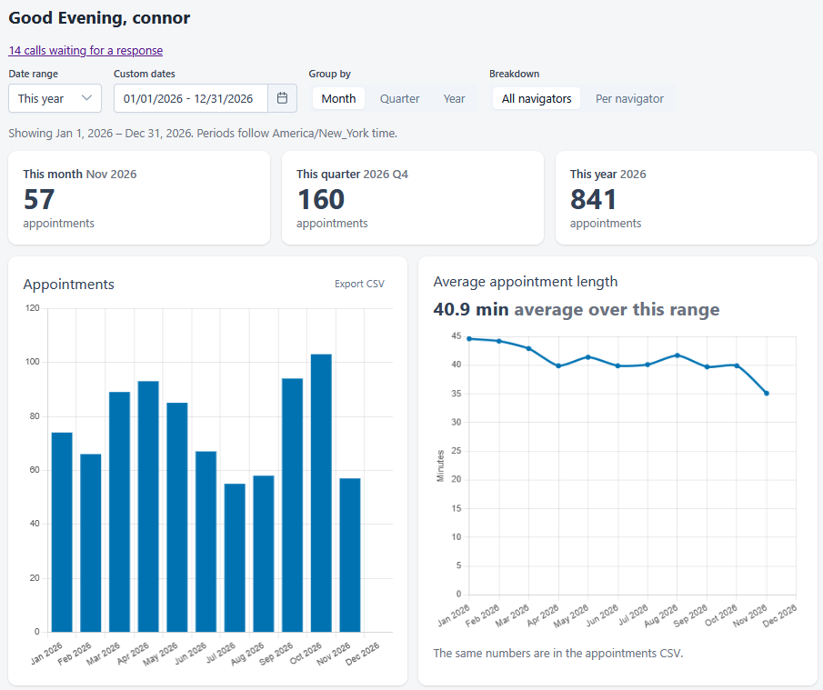
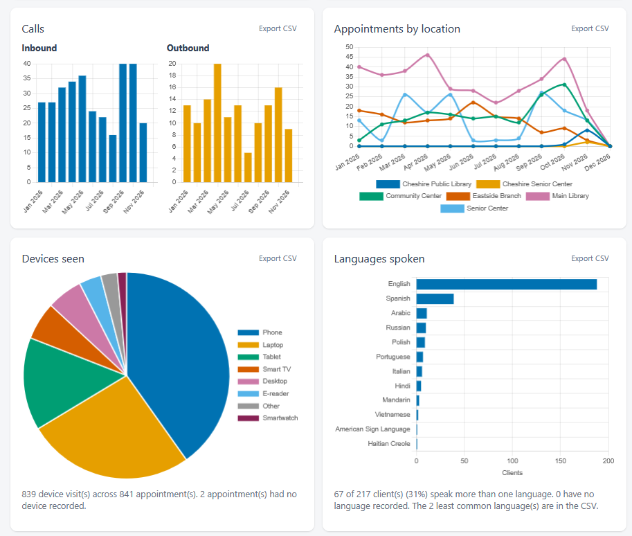
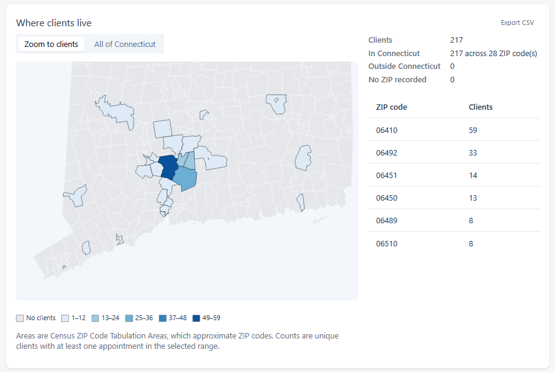
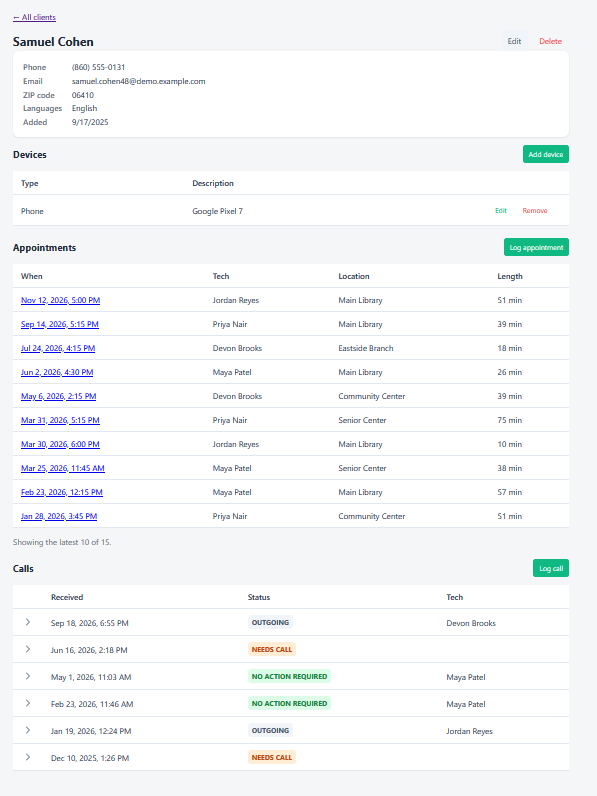
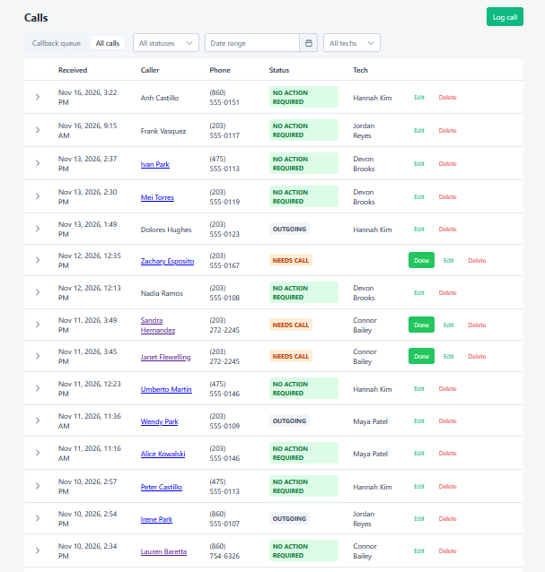
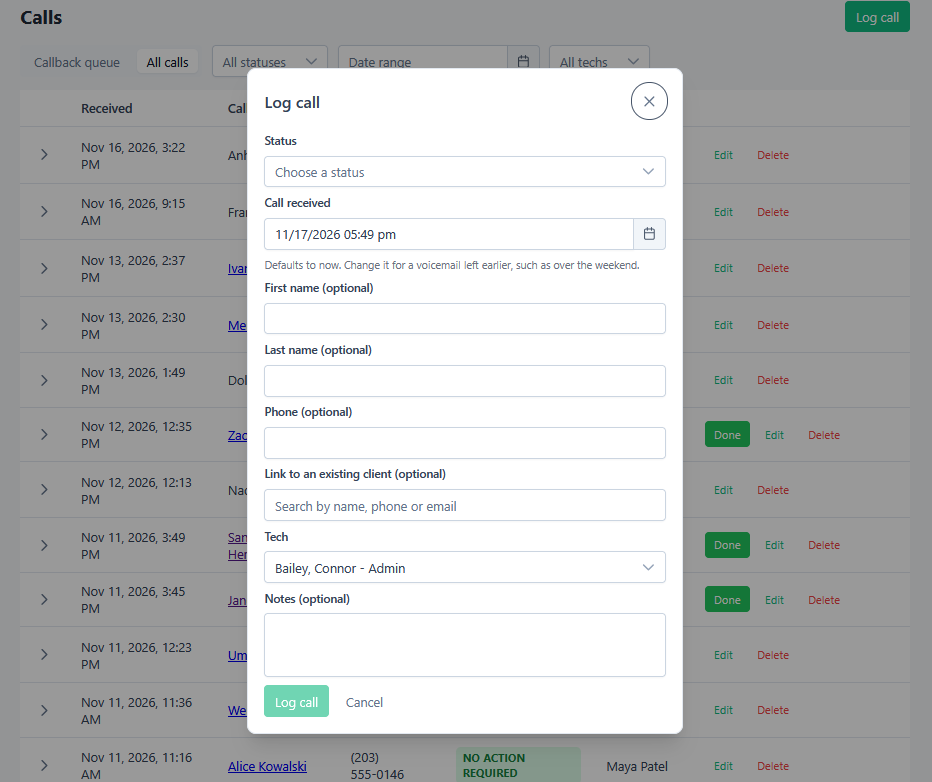

# Project-Athena (v0.5.0)

Project Athena is the open source CRM tooling for Connecticut Public Libraries in their work to provide Digital Navigation to their community. This tool allows staff in a libraries technology department to track unique clients across multiple appointments at different locations, and provide statistics, KPIs, and other useful metrics used for staffing, securing grants for future funding, and more. 

- Runs on Ubuntu Server inside the library's LAN (Local Area Network)
- No tracking, registration, or phoning home to third party companies or services
- Sign-in uses passwords plus two-step verification through your preferred TOTP authentication app
- Free for any library to use, change, and share (AGPL-3.0, see License)

### Table of Contents
- [Screenshots](#screenshots)
- [What You Need](#what-you-need)
- [Install](#install)
- [After install](#after-install)
  - [1. Create the first administrator](#1-create-the-first-administrator)
  - [2. Copy the certificate to staff computers](#2-copy-the-certificate-to-staff-computers)
  - [3. Sign in and set up two-step verification](#3-sign-in-and-set-up-two-step-verification)
  - [4. Set up your library](#4-set-up-your-library)
  - [5. Save your secrets offline](#5-save-your-secrets-offline)
- [Everyday commands](#everyday-commands)
- [Backups](#backups)
  - [Your Backup Key](#your-backup-key)
  - [Backing up to a USB drive](#backing-up-to-a-USB-drive)
- [Restoring from a Backup](#restoring-from-a-backup)
  - [What you need](#what-you-need)
  - [Steps to restore the backup](#steps-to-restore-the-backup)
- [Uninstalling](#uninstalling)
- [Troubleshooting](#troubleshooting)
- [Security](#security)
- [Contributing](#contributing)
- [License](#license)

## Screenshots













## What You Need

| | |
|---|---|
| **Server** | A computer running **Ubuntu Server** (tested on 26.04; 24.04 or newer should also work). At least 2 CPU cores, 2 GB memory (4 GB better), 20 GB free disk. |
| **Network**    | A wired connection and a fixed IP address for the server (ask your IT contact for a "DHCP reservation").     |
| **Where**    | A physically secure spot (locked room). Patron records are stored on it. The disk is not encrypted by default; see [SECURITY.md](SECURITY.md).     |
| **Employee**    | Someone comfortable typing commands over SSH or locally on the server. You do not need to be a programmer to complete the setup.     |
| **(Optional) USB Storage Device**    | Used for saving the automatic backups off of the server; see [Backups](#backups) for more information.     |

## Install
After booting Ubuntu Server, you have two different options:
1. Using physical access to the server with a mouse and keyboard.
2. Using a SSH connection (this requires knowing the IP address of the server ahead of time. You can find the IP address of the server by running `ifconfig` directly on the server. Look the IP address under eth0).

Next, copy and paste these lines:

```bash
sudo apt-get update && sudo apt-get upgrade -y && sudo apt-get install -y git
git clone https://github.com/TechnoEquinox/Project-Athena.git
cd Project-Athena
```
The first line update and upgrade the packages, then installs git.
The second line grabs the project's files from GitHub.
The third line then opens the root directory of the project.

Now we are ready to install Athena onto the system:

```bash
chmod +x install.sh installer/files/athena
sudo ./install.sh
```

The installer asks a few plain questions and explains each step as it goes:

1. Address for Athena: what staff will type in their browser. The server's IP address is suggested; use that if you are unsure.
2. Time zone and fiscal year start month (used in reports).
3. Firewall: it limits access to your library network. It checks first that it will not cut off your current connection.

It takes about 10 minutes. It is safe to run again if something stops it. It never replaces your existing secret settings.
When it finishes, it prints your next steps. They are repeated below.

## After Install

### 1. Create the first administrator
```bash
athena create-admin [INSERT ADMIN USERNAME HERE]
```

You will be asked for a password (12+ characters are required). Anything you type for the password is hidden. If you only want one person to have administration access, you can use the name ***admin***.

### 2. Copy the certificate to staff computers

Athena uses HTTPS with its **own private certificate**, so staff browsers show a warning until they trust it. The installer saves the certificate in your home folder on the server as **`athena-root-ca.crt`**. You can always re-create the certificate and see its fingerprint by running `athena cert`.

**To get the file off the server**, run this on the staff PC you wish to install the certificate on:

```bash
scp YOUR_USERNAME@SERVER_ADDRESS:athena-root-ca.crt .
```
YOUR_USERNAME is the user you setup on the Ubuntu Server during installation.
SERVER_ADDRESS is the IP address of the Ubuntu Server.
**NOTE:** The period ('.') at the end of the command is required.

You can also use any SFTP program (like WinSCP, FileZilla, Cyberduck). To confirm the file was not altered on the way, compare its fingerprint with the one the installer printed:

(Mac or Linux client)
```bash
openssl x509 -in athena-root-ca.crt -noout -fingerprint -sha256
```

(Windows client)
```bash
certutil -dump athena-root-ca.crt
```

Compare the SHA-256 values to make sure they match what is shown on the Ubuntu Server. If the values do not match, do not use the certificate and try again.

**Install it on each staff computer**

- **Windows (Edge / Chrome):** double-click the file → *Install Certificate* → *Local Machine* (needs admin) → *Place all certificates in the following store* → **Trusted Root Certification Authorities** → Finish. Restart the browser.
- **Mac (Safari / Chrome):** double-click the file (opens Keychain Access) → add to **System** → double-click the certificate → expand *Trust* → set *When using this certificate* to **Always Trust**.
- **Firefox (any computer):** Settings → Privacy & Security → *View Certificates* → *Authorities* → *Import* → tick *Trust this CA to identify websites*.
- **Library-managed PCs:** your IT team can push the file out with Group Policy or their device manager.

Once the certificate is installed, open your web browser and navigate to `https://YOUR_SERVER_IP_ADDRESS/`. The padlock should show no warnings and should verify the connection is secure. If you receive a warning that the connection is not secure, you likely have not installed the certificate correctly. 

### 3. Sign in and set up two-step verification

Sign in with the administrator account you created during the install. You will be guided to scan a QR code with an authenticator app (Google Authenticator, Microsoft Authenticator, Authy, Apple Passwords, etc.) and given **recovery codes**. **Print or write the recovery codes down and keep them somewhere safe.**

### 4. Set up your library

In the **Admin** page, add your **locations** first, then **navigators** (these are the entries of people who will be taking client appointments, and **users** (these are the user accounts used to login, you assign the role type to the user account, make sure to link a tech record ONLY for Digital Navigators). There are three roles with different access policies:

1. *admin* - Can access everything, including server administration settings
2. *manager* - Has read-only access, cannot make any changes
3. *navigator* - Can read/write clients, appointments, and calls for day-to-day usage

## Everyday commands

These commands can be run on the server. Each has its own unique function that helps to make managing the server easy:

| Command | What it does |
|---|---|
| `athena status` | Shows whether everything is running |
| `athena logs` | Recent activity (add `db` or `caddy` for other parts) |
| `athena restart` | Restarts Athena (data is kept) |
| `athena create-user` | Adds a staff account |
| `athena unlock-user NAME` | Unlocks someone who is locked out |
| `athena reset-totp NAME` | Resets someone's 2FA (lost phone) |
| `athena cert` | Re-saves the certificate and shows its fingerprint |
| `athena backup` | Makes an encrypted backup of the database, secrets, and user accounts |
| `athena backups` | List the backups made of the server |
| `athena backup-status` | Show when the last backup ran and the status of the backup |
| `athena restore FILE KEY` | Restore a backup (FILE = .tar.age, KEY = your saved private key) |
| `athena usb-setup` | Prepare a USB drive for backups (this will erase all of the data on a connected USB drive) |
| `athena restore-usb` | Restore from a backup saved to a USB drive |
| `athena version` | Shows the installed version |

Old deleted records are permanently removed after 30 days, and expired sessions are cleaned up, automatically each night.

Athena is designed so most of these commands are abstracted through the web interface (accessible only by admin users), so you don't have to constantly drop to the command-line to access these functions.

## Backups

Athena backs itself up automatically. Backups are encrypted with private/public key cryptography, so a stolen backup file or USB drive is unreadable without your private key.

- Backups occur automatically every night at 02:45am (server time)
- Backups are stored on the server in `/var/backups/athena` (only readable by root)
- Each backup holds the database, the settings file, the server's certificate authority, and your USB drive list
- Old backups are cleaned up automatically. Athena keeps the newest 14, plus the last backups of each of the most recent 12 months
- Optional (but recommended): Copies can be automatically stored on a USB drive, so the backups survive the loss of the server in the event of a hardware failure

### Your Backup Key

During installation, Athena creates a backup key and shows the **private key once**. The public key remains on the server. The private key looks like this:

```bash
AGE-SECRET-KEY-XXXXXXXXXXXXXXXXXXXXXXXXXXXXXXXXXXXXXXXXXXXXXXXXXXXXXXXXXXX
```

- Save the private key somewhere safe and **off the server**: somewhere like a Password manager, or printed and locked away
- **Without the private key, no backup can be opened. Nobody, including he Athena developers, can recover the backup**
- Keep it separate from the USB backup drive. Anyone holding both can read your data.

For more information on making a backup from the command-line, see [Everyday commands](#everyday-commands).

### Backing up to a USB drive

1. Plug in a USB drive into your Ubuntu Server. (Make sure you don't have anything on this flash drive that you don't mind loosing, as the flash drive will be erased)
2. Run `sudo athena usb-setup` and follow the prompts. You must type the drive's name to confirm.
3. From now on, every nightly backup is also copied to the drive when it is plugged in, and plugging in the drive starts a backup right away.

You can leave the drive plugged in, or remove it after each backup. If the USB drive isn't plugged in, backups will still be taken and will be saved for the next time you connect the drive.
`athena backup-status` will warn you if no copy has reached a USB drive in the past 7 days. Rotating two drives are keeping one off site is a good habit.
Remove the drive only when no backup is running, for example when `athena backup-status` shows the last backup finished.

## Restoring from a Backup

In the event that there is a hardware failure, disk replacement, or accidental deletion of data, you may have the need to recover from one of your backups. 

### What you need

1. Your private backup key
2. A backup file (either from `/var/backups/athena` or from a connected USB drive)

### Steps to restore the backup
1. Set up a fresh install of Athena. Follow the steps in [Install](#install).
2. Save your private key (the `AGE-SECRET-KEY-` line) into a file on the server. Save it to the home directory (`/home/USERNAME/backup-key.txt`)
3. Plug in the USB drive and run:

```bash
sudo athena restore-usb
```

4. Pick the backup you want to restore (1 is the newest) and give the **full file path** to your key file. Do not use `~` here, because `sudo` runs as another user. Type `RESTORE` when prompted
4a. To restore from a file on the server instead: `sudo athena restore /var/backups/athena/FILENAME.tar.age /home/USERNAME/backup-key.txt`
5. When the restore finishes, run `athena status`, then sign in with your **old** accounts. Accounts created after the backups were made (for example: during the setup of Athena) are now gone, as the restore process replaces all the authentication credentials with those from the backup. Restoring also brings back your original backup key setup and USB drive list, so future backups keep working. Staff computers do not need a new certificate, because the server's certificate authority is restored too. (If you installed a certificate from the fresh install, replace it with the original with `athena cert`.)

> **Restoring replaces all current data.** Always double check the backup's date in the list first.

## Uninstalling

If you ever have the need to perform a clean uninstall of Athena, you can use the included uninstaller. You may need to uninstall Athena to troubleshoot a specific issue, or repurpose this Ubuntu machine for something else. To uninstall Athena:

1. Run `sudo ./uninstall.sh --dry-run` first to see what would be removed. If everything looks correct, proceed to step 2
2. `sudo ./uninstall.sh` removes Athena, its database, and everything it installed. It keeps your backups and firewall rules unless you ask otherwise, and never touches your USB drive, your backup key, or the copy of this repository. See `./uninstall.sh --help`.

If you are reinstalling Athena on a different machine, staff computers will need the new certificate (a new one is created on install), unless you restore from a backup.

## Troubleshooting

- **Browser says the connection is not private:** the certificate is not installed on that computer yet (see above).
- **Page will not load at all:** run `athena status`. If `api` is restarting, run `athena logs`.
- **Cannot reach the server after it restarted:** its IP address may have changed (DHCP). Ask IT for a fixed address.
- **The installer stopped:** it tells you which step failed and writes details to `/var/log/athena-install.log`. Run it again; it picks up where it left off.
- **The installer stops at "Installing helper tools" or "Installing Docker":** the last lines of the log are printed on screen. Package conflicts usually mean two different Docker packages are installed at once (for example `docker-ce` and `docker.io`). Keep one of them, remove the other with `sudo apt-get remove`, then run the installer again.

When asking for help, include the last lines of that log. **Remove any passwords first.**

## Security

Please read [SECURITY.md](SECURITY.md) for how to report a vulnerability privately and for all of the assumptions made when running Athena.

This project's repository is scanned with Dependabot, which automatically reports security vulnerabilities in the packages that Athena requires. Make sure you are always running the most up-to-date version of Athena to get the latest security patches. 

## Contributing

See [CONTRIBUTING.md](CONTRIBUTING.md) for how to contribute to Athena.


## License

Project Athena is licensed under the **GNU Affero General Public License v3.0 or later** (AGPL-3.0-or-later). See [LICENSE](LICENSE).

In plain terms: you may use, study, change, and share Athena, including commercially. If you distribute it, or run a modified version as a service others use over a network, you must make your modified source code available under the same license.

This software is provided **without warranty** of any kind. You are responsible for how you use it and for protecting the information you store in it.
